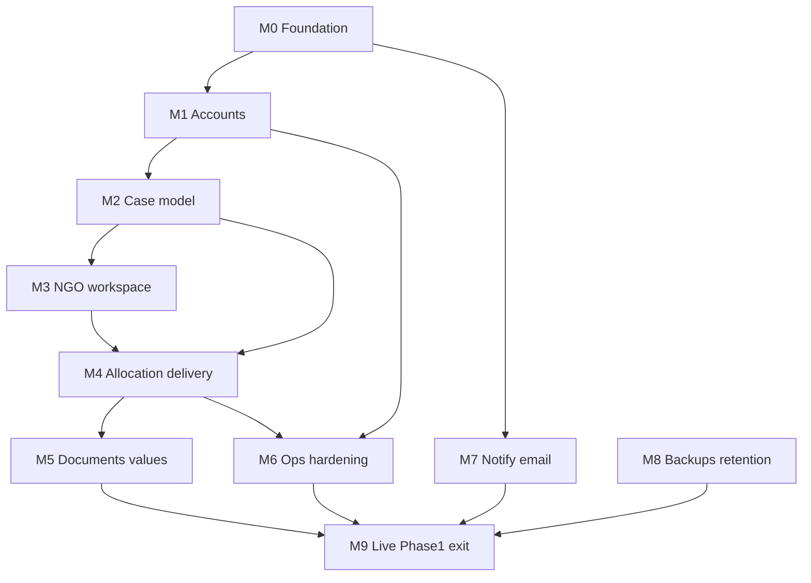

# Phase 1 completion roadmap

Stand: 2026-11-19 · Living checklist for finishing Phase 1.
Source brief: Phase 1 requirements (plain-language + explained editions, 6 Nov 2026).
Catalogue IDs (REQ-*) stay the source of truth; update status here after every merged slice.

**Phase 1 goal:** run one complete real donation inside the app — first contact to donation
receipt — without an Excel file beside it.

## How to update this file

After each PR that advances a REQ:

1. Change that item’s status: `Done` | `Partial` | `Todo` | `Blocked`.
2. Tick the checkbox when the “done when” criteria for that REQ are met in code (or mark
   Blocked with the decision/owner if external).
3. Refresh the progress summary table below.
4. Set **Next action** to the first incomplete item in dependency order (M0 → M9).

Status meaning:

| Status | Meaning |
|---|---|
| **Done** | In this clone and usable (preview and/or RPC/UI) |
| **Partial** | Code exists but incomplete wiring, fields, or ops config |
| **Todo** | Not built on the product path yet |
| **Blocked** | Waits on founder/ops decision or external config |

> “Merged” is not “working.” M9 (live exit) is separate: nothing counts as Phase 1 complete
> until proven with real accounts on production (Section 7 of the brief).

## Progress summary

| Milestone | Focus | Status |
|---|---|---|
| M0 | Foundation | Partial (OPS-13/14 + branch clean-up Done) |
| M1 | Accounts and access | Done |
| M2 | Donation CASE model | Partial (CORP-01 + CORP-02 Done; model migration Todo) |
| M3 | NGO workspace | Partial (NGO-05 + NGO-06 Done) |
| M4 | Allocation and delivery | Partial (MATCH-09 Done; MATCH-10 Todo) |
| M5 | Documents and values | Partial |
| M6 | Ops hardening | Partial |
| M7 | Notifications / email | Partial |
| M8 | Backups and retention | Todo |
| M9 | Live Phase 1 exit | Todo |

## Next action

**M4 / REQ-MATCH-10** — Delivery mode, date, address + part-deliveries per
allocation (MATCH-09 allocation ids now exist), or **REQ-NGO-04** receipt per
position if that unblocks the live path first.

Parallel / Blocked (ops + client, not code-first):
- REQ-AUTH-02 email delivery (Resend key present; Supabase Auth SMTP + DNS still needed)
- REQ-NFR-11 staging project (`staging` branch kept; checklist still open)
- REQ-NFR-13 branch protection + named reviewer
- Open PRs left open on purpose: Dependabot #32 (deps), ticketing #5 (templates) — decide later
- Model migration listing → case/position/allocation (unblocked: MATCH-09 done)
- MATCH-09 PR (`feat/req-match-09-position-allocation`) open for review; production DB
  already has migrations `0070`–`0073` applied ahead of `main`

---

## M0 — Foundation

Nothing user-facing can be trusted until this block is solid. Build/finish these before
pushing hard on M2+.

- [x] **REQ-OPS-13** Scheduler for timed jobs — **Done**
  - `scheduler_job_runs` + `run_scheduled_job` wrapper (0057); cron calls the wrapper.
  - Every run logs start / end / records processed; failures are audited and appear in
    Ops Approvals as `scheduler_job_failure` until acknowledged.
- [ ] **REQ-AUTH-02** Working email delivery — **Partial / Blocked**
  - Present: Resend path for invitations when `RESEND_API_KEY` is set; auth SMTP runbook.
  - Still needed: provider chosen + configured; SPF/DKIM/DMARC; login magic link reliable
    in a real inbox; local mail inspection. Blocked on client/ops config.
- [ ] **REQ-NFR-11** Staging environment with test data — **Partial**
  - Present: `docs/ops/staging-runbook.md`, `staging-go-live-checklist.md`,
    `supabase/seed.staging.sql`.
  - Still needed: finish checklist (SMTP/URL, exercised staging deploy with seed).
- [ ] **REQ-NFR-13** One rule for releasing code — **Partial**
  - Present: CI lint / typecheck / build / test / smoke (`.github/workflows/ci.yml`).
  - Still needed: branch protection on production/`main`, named reviewer, ticket check step.
- [x] **REQ-OPS-14** Two roles inside Ops (admin vs editor) — **Done**
  - `editor` on `user_role`; `is_ops()` / `is_ops_admin()`; AAL2 for both; plans/CO₂
    admin-only; day-to-day Ops (verify, propose/fail, risk queue) for either.
  - ADR 0032; migrations `0058`/`0059`; domain `ops-roles` + preview `usr-editor-ops`.
- [x] **Clean-up** Merge or close open branches — **Done** (2026-11-11)
  - Deleted after merge into `main`: `feat/req-ops-13-…`, `feat/req-ops-14-…`.
  - Deleted stale empty tip: `dev` (0 unique commits vs `main`).
  - Kept: `main`, `staging` (env branch; refresh separately under NFR-11).
  - Left open: Dependabot PR #32, ticketing PR #5 (not Phase 1 product path).

---

## M1 — Accounts and access

- [x] **REQ-AUTH-03** No free email for companies — **Done**
  - `0031_corporate_freemail_block.sql`, `packages/domain/src/freemail.ts`.
- [x] **REQ-AUTH-04 / REQ-AUTH-05** Invitations + access requests — **Done**
  - Invite RPCs/UI; `/request-access`; Ops intake `/ops/requests`.
- [x] **REQ-AUTH-01** Sign-up is an application, not instant access — **Done**
  - `claim_workspace` + verification gating for match/contact/docs;
    NGO needs create as `draft` until verified, promote on Ops approve (`0060`/`0061`).
  - Unverified company browse-only (plain UI); listing create gated on verification
    (`0063`, ADR 0027 over katalog).
- [x] **REQ-PLAN-01 … REQ-PLAN-05** Registered / Seed / Tree — **Done**
  - `PLAN_ENTITLEMENTS`, seats on invite, quota at `both_confirmed` (ADR 0026).
- [x] **REQ-PLAN-06** Payment by hand for Phase 1 — **Done**
  - Manual `set_company_plan` is the P1 path (Stripe exists but is Phase 2).
- [x] **REQ-LEGAL-01** Terms accepted per version — **Done** (live prove in M9)
  - `accept_agreement` + clickwrap gating.

---

## M2 — Donation CASE model

Largest architectural gap. Unblocks CORP-02, MATCH-09/10, CORP-04, NGO-04.

Today the product is **listings → matches**. Phase 1 needs **one case → many positions →
allocations to organisations**.

- [x] **REQ-CORP-01** Donation is one case with positions — **Done** (first slice; ADR 0033)
  - Case holds step (1–7), contact, location, time window.
  - Positions: category, model, quantity, condition, provenance + state.
  - CSV import with DE/EN column mapping (`parseDonationPositionCsv` + import RPC).
  - `/cases` + `/cases/[caseId]` show every position and its state.
  - Parallel to listings: matching still listing-centric until MATCH-09.
- [x] **REQ-CORP-02** Confirmation gate before any allocation — **Done** (ADR 0034)
  - Explicit confirm sets `confirmed_at`, step → 4, positions `ready` → `confirmed`, audited.
  - `assertDonationCaseAllocatable` + SQL `donation_case_is_confirmed` for MATCH-09.
  - Add/import after confirm reopens (`confirmed_at` cleared, step → 2, audit).
- [ ] **Model migration** listing-centric → case / position / allocation — **Todo**
  - Domain model, repository, RPCs, UI; one code path for transitions (keep REQ-MATCH-02).

---

## M3 — NGO workspace

- [x] **REQ-NGO-01 / REQ-NGO-02** Verification with proof — **Done**
  - Proof upload; Ops `/ops/ngos`; approve blocked without proof; decisions audited.
- [x] **REQ-NGO-05** Full needs profile — **Done** (ADR 0035, migration `0067`)
  - Delivery preference (collect / ship / either), max qty per match (enforced at
    propose), target group, delivery address ≠ registered, vehicle flag.
  - `/needs` form + `create_need` (preview + RPC); directory exposes non-contact
    logistics only (preference / max / target group).
- [x] **REQ-NGO-06** Proof expiry + reminders — **Done** (ADR 0036, migration `0068`)
  - Notice date + assessment period years on Ops approve; `proof_valid_until` derived.
  - `warn_expiring_ngo_proofs` / `expire_ngo_proofs` via `run_scheduled_job`.
  - On expiry: demote to `verification_pending`; block new `propose_match`; existing
    matches stand. `public_body` has no notice expiry path.
- [ ] **REQ-NGO-04** Confirming receipt per position — **Partial**
  - Present: match-level `delivered → completed` with email step-up (`0037`).
  - Still needed: per-position quantity/date confirm (can hang off MATCH-09
    allocation ids).

---

## M4 — Allocation and delivery

- [x] **REQ-MATCH-01** Human decides; system only suggests — **Done**
  - Ops-only `propose_match` / ProposeMatchPanel.
- [x] **REQ-MATCH-02** One status flow, one code path — **Done**
  - `transition_match` + domain mirror (incl. expired / failed).
- [x] **REQ-MATCH-03** Contact details only after both confirm — **Done** (live prove in M9)
  - Server RLS / `match_unlocks_contact`; preview redaction.
- [x] **REQ-MATCH-05** Quota counting — **Done** (revisit if founders change the rule)
  - Consumed at `both_confirmed`. Proposal in brief: one allocation to one org within a case.
- [x] **REQ-MATCH-09** Allocation per position + organisation — **Done** (ADR 0037, migrations `0070`–`0073`)
  - One id: position + org + quantity + status; sum ≤ confirmed qty (server).
  - NGO written release of claim; quantity freed; audited.
  - Preview repo + `create_donation_allocation` / `release_donation_allocation`;
    case UI create/view; NGO cockpit release; Ops **Cases** tab lists all cases.
  - Label snapshot on allocations (`0071`); company-verified gate + re-confirm keeps
    `allocated` (`0072`). Proven manually on production (2026-11-19).
  - Founder call (2026-11-19): **only Ops allocates** (`0073`); company sees its
    claims read-only.
- [ ] **REQ-MATCH-10** Delivery mode, date, address — **Todo**
  - Mode mandatory before `in_transit`: on-site / company ships / NGO collects.
  - Part-deliveries per allocation (date + quantity).
  - Delivery address under contact gate.

---

## M5 — Documents and values

- [x] **REQ-DOC-02** Donation receipt PDF + NGO countersign — **Done**
  - Certificate on completion; `confirm_donation_certificate`; PDF download.
- [ ] **REQ-DOC-05** Residual value per position with sources — **Todo / Blocked**
  - Market-source table (offer, date, price, link); German sources; lowest by default.
  - Derive residual net, VAT, donation value; totals per org/case; archive with document.
  - Blocked on tax-advisor confirmation of formula (Section 6).
- [ ] **REQ-DOC-01 / REQ-OPS-08** No donation value without stored proof — **Partial**
  - Present: countersign requires uploaded evidence (`0028`).
  - Still needed: Ops recorded proof-check step before receipt issuance.
- [ ] **REQ-CORP-04** Company status overview + PDF/Excel — **Partial**
  - Present: corporate cockpit; CSRD HTML/CSV export.
  - Still needed: per-case operational totals (allocated / handed over / remaining /
    residual values) exportable as PDF and Excel.

---

## M6 — Ops hardening

Depends on M1 roles story; task entity benefits from M2 case ids.

- [x] **REQ-OPS-01** First administrator via bootstrap — **Done**
- [x] **REQ-OPS-03** Decide NGO verification with proof on screen — **Done**
- [x] **REQ-OPS-09 / REQ-OPS-10** Plans by hand + audit trail — **Done**
- [ ] **REQ-OPS-02 / REQ-OPS-11** Work queue and tasks — **Partial**
  - Present: risk queue `/ops`, `/ops/approvals`.
  - Still needed: task entity (when / what / who / why / case-or-org); auto tasks
    (e.g. promise without delivery date after 7 days); due tasks in same queue.
- [x] **REQ-NFR-03** Admin 2FA / AAL2 — **Done**
- [x] **REQ-NFR-04 … REQ-NFR-09** Security baseline — **Done**
  - Sessions, shared rate limit, RLS, api-contract / security-controls, CSP.

---

## M7 — Notifications

Depends on M0 email delivery.

- [ ] **REQ-NOTIFY-01 / REQ-NOTIFY-03** Three emails — **Partial**
  - Present: in-app notifications for proposed / both_confirmed / delivered (`0043`).
  - Still needed: branded outbound email for those three events via chosen provider;
    receipt confirmation keeps its second confirmation step (not one-click complete).

---

## M8 — Backups and retention

- [ ] **REQ-NFR-12** Backups before first real record — **Todo**
  - Daily backups ≥7 days; weekly dump outside provider; one restore exercised and written up.
- [ ] **REQ-NFR-15** Retention and deletion — **Todo**
  - Named periods; deletion request → Ops task; anonymise under retention duty;
    system/data-flow map; deletion scripts tested once.

---

## M9 — Phase 1 exit (Section 7)

All **Todo** until someone watches them on production with real accounts.

- [ ] One real donation runs contact → inventory → confirm → allocation → handover →
      paperwork → report, entirely in the app.
- [ ] Allocation to ≥2 organisations, including one part-delivery and one released quantity,
      without Excel.
- [ ] Confirmation gate blocked an allocation before the list was final (proven live).
- [ ] Contact gate hid details until both confirmed (two real accounts).
- [ ] Donation receipt produced from stored residual values with sources.
- [ ] Backup restored once; result and duration written down.
- [ ] User accepted terms; acceptance stored.
- [ ] Scheduler ran for a week; every run visible in the log.

---

## Phase 2 — do not prioritize (already partly in tree)

Section 5 of the brief. Code may already exist; do not rebuild or treat as Phase 1 scope.

| ID / topic | Note in this clone |
|---|---|
| REQ-MATCH-06/07, NOTIFY-02 | 14-day expiry + warning cron present; needs reliable scheduler (M0) |
| REQ-MATCH-08 / OPS-07 | CO₂ factors (`0054`) |
| REQ-DOC-04 / NFR-14 | DocuSeal e-signature (`0055`) |
| REQ-OPS-04 | Company auto-check (`0044`) |
| REQ-NFR-16 | DE/EN UI chrome i18n |
| AI agent | Agent runs / listing create |
| REQ-PLAN-06 card path | Stripe checkout (manual plan remains P1) |
| REQ-CORP-03, MATCH-11/12, NGO-07/08, MATCH-13, DOC-07, AUTH-06 | Not required for Phase 1 exit |

---

## Open founder decisions (block design, not just coding)

From Section 6 of the brief — ask; do not assume:

1. **Email provider** — transactional-only vs European all-in-one (blocks M0 AUTH-02 / M7).
2. **Valuation model** — tax advisor confirms REQ-DOC-05 formula and admissible proof (blocks M5).
3. **What counts as one match** — proposal: one allocation to one org within a case (may adjust M4 quota).
4. **Who wipes IT equipment** — company vs brokered wipe; align website copy.
5. **First paying customer / contract basis** — terms live before next invoice (M1 LEGAL-01 / M9).
6. **Named code reviewer + deputy** — nobody merges own work (M0 NFR-13).
7. **Login paths** — magic link only vs also password; who uses which (M0 AUTH-02).

Resolved:

- **Who allocates** (2026-11-19) — only Ops allocates positions to NGOs; the company sees
  its claims read-only (ADR 0037, migration `0073`).

---

## Working rule for the next PRs

Always take the **Next action** at the top of this file. Prefer small verified slices
(`typecheck` + `test` + `build` green). Do not start M2 CASE work until M0 foundation
items are Done or explicitly deferred; CASE work is the largest change and needs a
stable foundation and a clear reviewer.
